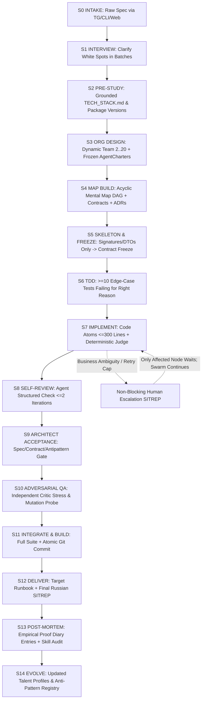

# ORCHESTRA Architecture

**ORCHESTRA** is a resident, local-first, autonomous multi-agent software engineering factory
built on pure Python `asyncio` + Pydantic v2. It transforms raw human specifications into verified,
tested, git-committed software while continuously evolving reusable agent professions
(`/agent_talents/`) and isolated executable skills (`/skills/`).

---

## 1. Layered System Diagram (L0–L7)

```
                    ┌────────────────────── ЧЕЛОВЕК ──────────────────────┐
                    │  Telegram Bot  │  Web Dashboard  │  CLI (Rich)      │
                    └───────┬────────┴────────┬────────┴────────┬─────────┘
                            │  SITREP (RU)    │  WebSocket      │  TTY
        ════════════════════╪═════════════════╪═════════════════╪══════════ L7 HUMAN INTERFACE
                            ▼                 ▼                 ▼
                    ┌───────────────────────────────────────────────────────┐
                    │              ORCHESTRA CORE (FastAPI + asyncio)       │
                    │  ┌─────────────┐  ┌──────────────┐  ┌──────────────┐  │
                    │  │  ARCHITECT  │  │  ESCALATION  │  │ TELEMETRY /  │  │
                    │  │ (Meta-Agent)│◄─┤   MANAGER    │  │   AUDIT LOG  │  │
                    │  └──────┬──────┘  └──────────────┘  └──────────────┘  │
        ═══════════════════════╪═══════════════════════════════════════════ L6 ORCHESTRATION
                             ▼
                    ┌───────────────────────────────────────────────────────┐
                    │        DYNAMIC SWARM SCHEDULER (topological)          │
                    │  agent_01   agent_02   agent_03  ...  agent_N         │
                    │  (Charter)  (Charter)  (Charter)     (Charter)        │
                    └──────┬───────────┬───────────┬───────────┬────────────┘
        ══════════════════╪═══════════╪═══════════╪═══════════╪════════════ L5 AGENT RUNTIME
             RPC bus ◄────┴───────────┴───────────┴───────────┘
        ══════════════════════════════════════════════════════════════════ L4 COMMUNICATION
                    │                     │                     │
                    ▼                     ▼                     ▼
        ┌───────────────────┐  ┌────────────────────┐  ┌────────────────────┐
        │  MENTAL MAP SSOT  │  │  SKILLS REGISTRY   │  │ TALENTS + DIARIES  │
        │  nodes/ADR/anti   │  │  /skills/ + mfst   │  │  /agent_talents/   │
        └─────────┬─────────┘  └─────────┬──────────┘  └──────────┬─────────┘
        ══════════╪══════════════════════╪═══════════════════════╪═════════ L3 STATE & MEMORY
                  ▼                      ▼                       ▼
        ┌──────────────────────────────────────────────────────────────────┐
        │   VALIDATION SANDBOX  →  PATCH ENGINE  →  GIT OPS  →  TARGET FS  │
        └──────────────────────────────┬───────────────────────────────────┘
        ═══════════════════════════════╪═══════════════════════════════════ L2 VERIFICATION
                                       ▼
        ┌──────────────────────────────────────────────────────────────────┐
        │  KEY POOL (lease/cooldown/429)  →  LLM CLIENT (dual-stream)      │
        │  reasoning_content ─► AUDIT+UI   content ─► VALIDATORS ─► ARTEF  │
        └──────────────────────────────────────────────────────────────────┘
        ═══════════════════════════════════════════════════════════════════ L1 INFERENCE
        ═══════════════════════════════════════════════════════════════════ L0 CONFIG/SECRETS
```

---

## 2. Layer Responsibilities & Dependency Direction

Strict acyclic dependency rule: **Layer `N` imports only from Layers `< N`**. Upward notifications
occur exclusively via `Protocol` callbacks or the typed `EventBus`. An automated AST import-graph
test (`T-13`) enforces zero cycles and zero upward layer violations.

| Layer | Packages | Responsibility | Forbidden Knowledge |
|---|---|---|---|
| **L0 Config & Secrets** | `orchestra.config`, `orchestra.errors`, `orchestra.security` | Typed Pydantic Settings (`ORCHESTRA_*`), constant registry, fail-fast validation, secret redaction, prompt-injection filtering | Providers, HTTP, agents, mental map |
| **L1 Inference** | `orchestra.providers`, `orchestra.inference` | `LLMProvider` protocol, capability probe, `KeyPoolManager` (lease/cooldown/token-bucket/429 failover), dual-stream `LLMClient` (`reasoning` vs `content`), structured JSON extraction & repair, disk response cache | Agents, DAG nodes, skills, sandbox |
| **L2 Verification** | `orchestra.verify` | Cross-platform `Sandbox` (`subprocess` with Windows Job Objects / POSIX `setrlimit`, optional `docker`), language `Verifiers`, `DeterministicJudge` (`ast → ruff → mypy → pytest`), `PatchEngine`, atomic `GitOps` | LLMs, prompts, swarm orchestration |
| **L3 State & Memory** | `orchestra.state`, `orchestra.skills`, `orchestra.talents` | `MentalMap` DAG & table-driven FSM, single-writer `StateStore` (atomic snapshot + JSONL event log + optimistic concurrency + crash recovery), frozen `ContractRegistry`, isolated `Skills` + `MutationGate`, `Talents` + `EmpiricalProofGate` diaries | HTTP clients, Telegram, Web UI |
| **L4 Communication** | `orchestra.comms` | `INTER_AGENT_RPC_V1` envelopes, ASCII Telegraphic English validator, persistent `EventBus` + outbox, `DisagreementTicket` & non-blocking `EscalationManager` | Direct LLM calls, UI rendering |
| **L5 Agent Runtime** | `orchestra.agents`, `orchestra.prompts` | Frozen `AgentCharter`, 20/30/50 `ContextBudget` prompt builder, `AgentRuntime` Think→Act→Observe node execution loop | Global graph mutation, sibling internals |
| **L6 Orchestration** | `orchestra.swarm`, `orchestra.research`, `orchestra.telemetry`, `orchestra.domains` | Meta-Architect, `OrgDesign`, critical-path topological `Scheduler`, `Skeleton/Judge/Architect/QA` gates, deadlock & stall detectors, PyPI/AST `Grounding`, metrics, circuit breaker, pluggable `DomainPack` (`crypto_trading`) | Raw UI rendering |
| **L7 Human Interface** | `orchestra.interfaces`, `orchestra.web` | Thin clients consuming the core API & event stream: FastAPI REST + WebSocket server, offline vanilla JS + Cytoscape.js Web Dashboard, `aiogram 3.x` Telegram SITREP bridge, `Typer` + `Rich` live CLI | Business logic, direct state writes |

---

## 3. Canonical End-to-End Pipeline (`S0` → `S14`)



---

## 4. Concurrency, Persistence & Crash Recovery

1. **Single Event Loop + Bounded Semaphores:** One `asyncio` loop (`ProactorEventLoop` required on
   Windows) governed by `MAX_CONCURRENT_AGENTS` (6) and `MAX_CONCURRENT_LLM_CALLS` (8), structured
   with `asyncio.TaskGroup` and guaranteed `try/finally` lease cleanup on cancellation (`KP-08`).
2. **Single-Writer Actor (`StateStore`):** All map mutations pass sequentially through an internal
   `asyncio.Queue` with `expected_version` optimistic concurrency checks (`StaleStateError`).
   Readers obtain immutable snapshots without holding locks.
3. **Atomic Write + Event Sourcing:** Every state transition appends to `events.jsonl` first and
   periodically writes `mental_map.json` via `temp → flush → fsync → os.replace` (with exponential
   backoff retries on Windows `PermissionError` over locked files, `WIN-08`), keeping 5 rolling
   snapshot backups.
4. **Deterministic Recovery (`recovery_scan`):** After `SIGKILL` / `TerminateProcess`, startup
   verifies snapshot SHA-256 checksums, replays `events.jsonl` after `snapshot_seq`, transitions
   expired-lease active nodes to `INTERRUPTED` → `SKELETON_PENDING`/`BACKLOG`, and restores open
   human questions with remaining timeout budgets.

---

## 5. Cross-Platform Layer (Windows Primary, POSIX Secondary)

- **Process Isolation & Tree Termination (`WIN-01..06`):** `ResourceLimiter` dispatches by
  `sys.platform` between Windows Job Objects (`JOB_OBJECT_LIMIT_PROCESS_MEMORY`,
  `JOB_OBJECT_LIMIT_ACTIVE_PROCESS`, `JOB_OBJECT_LIMIT_KILL_ON_JOB_CLOSE`) and POSIX `setrlimit` /
  `os.killpg`. Graceful timeout sends `CTRL_BREAK_EVENT` / `SIGTERM`, followed after `GRACE_KILL_S`
  by `TerminateProcess` / `SIGKILL`.
- **Filesystem Safety (`WIN-07..13`):** `pathlib.Path` everywhere, case-insensitive collision guard
  (`CaseCollisionError` via `os.scandir`), enforced `\n` line endings (`newline="\n"`,
  `core.autocrlf=false`), long-path warning (`240` chars) and `\\?\` support, `UTF-8` subprocess
  environments (`PYTHONUTF8=1`, `PYTHONIOENCODING=utf-8`, `errors="replace"`).
- **Sandbox Degradation (`WIN-18..20`):** `subprocess` mode is default; `docker` mode uses Docker
  Desktop + WSL2 with `to_container_path` translation and degrades cleanly to `subprocess` with a
  diagnostic warning if Docker is unavailable.

---

## 6. Pluggable Domain Packs (`crypto_trading`)

Domain expertise is encapsulated behind the `DomainPack` protocol (`orchestra/domains/base.py`) so
the core factory remains universal while enforcing strict domain invariants:
- **20 Hard Trading Invariants (`TR-01..TR-20`):** `Decimal`-only monetary arithmetic, UTC-aware
  timestamps, mandatory `clientOrderId`, `UNKNOWN` order state on network timeout prior to
  reconciliation, L2 orderbook snapshot+delta resync, non-bypassable pre-trade risk checks, kill
  switch, event-driven look-ahead-free backtesting, `PAPER` mode by default.
- **Multi-Exchange Day-One Architecture (`§38.19`):** Data-driven `exchanges.yaml` registry
  (fail-closed `enabled: []`), `ExchangeCapabilities`, normalized `BASE/QUOTE:SETTLE` schema,
  `ccxt` baseline + native overrides, isolated per-exchange rate limiters/clock skew/reconciliation,
  and `CrossExchangeTimeAligner`.
- **13 Custom AST Verifier Rules (`§38.13`), 12 Executable Domain Skills (`§38.12`), 8 Seeded
  Talent Profiles (`§38.11`), and a 34-Node Canonical Project Decomposition (`§38.15`).**
